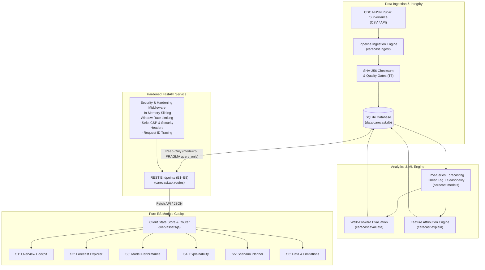

# CareCast — Respiratory Admission Forecasting & Capacity Cockpit

[](https://www.python.org/)
[](https://fastapi.tiangolo.com/)
[](https://www.sqlite.org/)
[](https://www.w3.org/WAI/standards-guidelines/wcag/)
[](LICENSE)

> **Decision-support prototype. Not clinically validated. Uses public CDC data.**

**Project Creators:** Kishor G and Thanujaa P  
**Repository:** [https://github.com/Kxhor/CareCast.git](https://github.com/Kxhor/CareCast.git)  
**Status:** Completed & Verified (`phase-1-approved` through `phase-7-approved`)

---

## Table of Contents

- [1. Executive Overview](#1-executive-overview)
- [2. System Architecture](#2-system-architecture)
- [3. Core Capabilities](#3-core-capabilities)
- [4. Technology Stack](#4-technology-stack)
- [5. Getting Started & Installation](#5-getting-started--installation)
- [6. Pipeline & Operational Workflows](#6-pipeline--operational-workflows)
- [7. REST API Contract (E1–E8)](#7-rest-api-contract-e1e8)
- [8. Automated Verification & Quality Audits](#8-automated-verification--quality-audits)
- [9. Repository Structure](#9-repository-structure)
- [10. Documentation Index](#10-documentation-index)
- [11. System Limitations (L-01–L-12)](#11-system-limitations-l-01l-12)
- [12. License & Attribution](#12-license--attribution)

---

## 1. Executive Overview

**CareCast** is a transparent, explainable decision-support cockpit engineered to forecast weekly respiratory hospital admissions (Influenza, COVID-19, and RSV) at the national level using open public surveillance datasets from the Centers for Disease Control and Prevention (CDC).

Hospital operations teams require early warning signals for capacity strain without relying on opaque, black-box predictions. CareCast couples leak-free statistical time-series forecasting with calibrated uncertainty bounds, transparent persistence baselines, plain-language feature attribution, surge scenario planning, and an accessible, high-contrast browser cockpit.

### Core Value Pillars

- **Leak-Free Machine Learning:** Enforces strict chronological walk-forward evaluation splits across 12-week test horizons; zero future-data leakage.
- **Calibrated Prediction Intervals:** Produces empirical 90% prediction intervals derived from walk-forward residual percentiles without Gaussian assumptions.
- **Honest Persistence Benchmarking:** Every model is transparently evaluated against naive persistence; automated verdicts state plainly whether a model beats or fails persistence.
- **Explainable Attribution:** Quantifies lag and seasonality feature contributions labeled explicitly as *"Associations, not causes"*.
- **Hardened Cockpit Architecture:** Pure Vanilla ES Modules with zero node build steps, zero third-party framework runtime dependencies, WCAG AAA color contrast, and strict Content Security Policy (`default-src 'self'`).

---

## 2. System Architecture



---

## 3. Core Capabilities

### Surveillance & Forecasting
- **Multi-Pathogen Tracking:** Synchronized surveillance of Influenza, COVID-19, and RSV with pathogen-specific baselines and thresholds.
- **1 to 4-Week Forecasting:** Forecasts admission trajectories across 1–4 week planning horizons.
- **Empirical Uncertainty Bounds:** Calibrated 90% intervals (5th–95th percentile historical residuals) providing conservative operational envelopes.

### Decision Support & Risk Tiers
- **Capacity Alert Tiers:** Automatic categorization of forecast trajectories into **Normal**, **Watch**, or **Elevated** based on configured hospital planning thresholds.
- **Interactive Scenario Planner:** Sandbox for stress-testing hospital bed requirements under hypothetical surge percentages (e.g., +10%, +20%, +30%), prominently marked **"SCENARIO — not a prediction"**.
- **Plain-Language Explainability:** Deconstructs forecast drivers into short-term momentum vs. seasonal baselines, preventing misinterpretation as clinical causal claims.

---

## 4. Technology Stack

| Layer | Technologies | Rationale |
|---|---|---|
| **Backend Runtime** | Python 3.11+, FastAPI, Uvicorn | High-performance asynchronous REST API with standard type validation. |
| **Data & Storage** | SQLite 3, SQLite WAL mode | Zero-dependency, file-based relational database; read-only query enforcement (`mode=ro`). |
| **Statistical ML** | NumPy, Pandas, Scikit-Learn | Transparent linear regression, seasonal Fourier harmonics, and empirical percentile residuals. |
| **Frontend Cockpit** | Vanilla JavaScript (ES2022 Modules), Pure CSS | Zero build step, zero npm runtime dependencies, zero bundling overhead. |
| **Data Visualization** | Chart.js 4.4.7 (Vendored UMD) | Lightweight, accessible charting with high-contrast color palettes and table fallbacks. |
| **Testing & Quality** | Pytest, HTTPX, Playwright, Pip-Audit | Comprehensive unit tests, OpenAPI contract tests, accessibility audits, and security scans. |

---

## 5. Getting Started & Installation

### Prerequisites
- **Python 3.11 or higher**
- Git

### 1. Clone the Repository
```bash
git clone https://github.com/Kxhor/CareCast.git
cd CareCast
```

### 2. Set Up Virtual Environment
```bash
# Create virtual environment
python -m venv .venv

# Activate environment
# On Linux/macOS:
source .venv/bin/activate
# On Windows:
.\.venv\Scripts\activate

# Install development dependencies
pip install -r requirements-dev.txt
```

### 3. Initialize & Build the Database
```bash
# Runs migrations, ingests CDC surveillance data, and fits models
python -m carecast.pipeline rebuild
```

### 4. Launch the Application
```bash
# Run in production mode (hardened security headers, docs disabled)
python -m uvicorn carecast.api.main:create_app --factory --host 127.0.0.1 --port 8000
```
Open your browser and navigate to `http://127.0.0.1:8000`.

---

## 6. Pipeline & Operational Workflows

The offline pipeline (`carecast.pipeline`) handles all database schema migrations, raw data ingestion, quality audits, model training, and backtesting:

```bash
# Full pipeline rebuild (migrate -> ingest -> train -> evaluate)
python -m carecast.pipeline rebuild

# Run data quality & anomaly detection checks
python -m carecast.pipeline check

# Run database migrations only
python -m carecast.pipeline migrate
```

### Configuration Environment Variables

Configured via environment variables or `.env` file (see [`.env.example`](.env.example)):

| Variable | Default | Purpose |
|---|---|---|
| `CARECAST_ENV` | `prod` | `dev` enables interactive Swagger docs; `prod` disables them. |
| `CARECAST_DB_PATH` | `data/carecast.db` | Path to the SQLite database. |
| `CARECAST_ENABLE_DOCS` | `0` | Exposes `/docs` and `/redoc` (honored only when `CARECAST_ENV=dev`). |
| `CARECAST_RATE_GET_PER_MIN` | `60` | Sliding-window GET request rate limit per client IP. |
| `CARECAST_RATE_POST_PER_MIN` | `20` | Sliding-window POST request rate limit per client IP. |
| `CARECAST_LOG_LEVEL` | `INFO` | Logging verbosity (`DEBUG`, `INFO`, `WARNING`, `ERROR`). |
| `CARECAST_HSTS` | `0` | Injects HTTP Strict Transport Security header over HTTPS. |

---

## 7. REST API Contract (E1–E8)

All backend endpoints are stateless, read-only (except scenario computation), and respond strictly with JSON conforming to OpenAPI schemas:

| Endpoint | Method | Description |
|---|---|---|
| `/api/v1/health` | `GET` | Service status, database connectivity, data version, and data-as-of date. |
| `/api/v1/meta` | `GET` | System metadata, supported pathogens, horizons, and data quality findings. |
| `/api/v1/summary` | `GET` | Executive surveillance KPI summary, disease watchlist, and alert tiers. |
| `/api/v1/forecast` | `GET` | 1–4 week ahead point forecasts with 90% prediction intervals. |
| `/api/v1/evaluation` | `GET` | Backtesting performance metrics (MAE, RMSE, MAPE) vs. persistence baseline. |
| `/api/v1/explain` | `GET` | Feature attribution breakdowns with non-causal disclaimer labeling. |
| `/api/v1/capacity` | `GET` | Hospital bed utilization estimates, threshold ratios, and buffer margins. |
| `/api/v1/scenario` | `POST` | Calculates hypothetical surge scenarios (strictly marked simulated). |

---

## 8. Automated Verification & Quality Audits

The project includes an automated verification script enforcing regression testing, import integrity, and supply chain vulnerability scanning:

```bash
# Run full verification suite (Pytest + Smoke Test + pip-audit)
python scripts/verify.py

# Run unit, API, and contract tests only
python -m pytest -q

# Run end-to-end browser tests via Playwright
python -m pytest tests/e2e -q

# Capture responsive viewport screenshots (320px to 1440px)
python scripts/capture_screenshots.py
```

### Verification Criteria
- **Pytest Suite:** 76+ test cases verifying mathematical engines, API schemas, rate limiters, and error handling.
- **Contract Integrity:** OpenAPI snapshot cryptographic SHA-256 lock verification.
- **Supply Chain Security:** Zero known CVEs reported via `pip-audit`.
- **Content Security Policy:** Strict CSP (`default-src 'self'`) with 0 inline style/script violations.

---

## 9. Repository Structure

```
CareCast/
├── carecast/                   # Core Python application package
│   ├── api/                    # FastAPI routes, schemas, rate limiter, middleware
│   ├── db.py                   # SQLite connection management & query_only safety
│   ├── evaluate.py             # Walk-forward cross-validation & evaluation metrics
│   ├── explain.py              # Feature attribution and non-causal explanation
│   ├── features.py             # Lag creation and seasonal harmonic transforms
│   ├── ingest.py               # CDC NHSN raw data parser & ingestion
│   ├── models.py               # Linear regression and persistence baseline engines
│   ├── pipeline.py             # CLI pipeline orchestrator (rebuild, check, migrate)
│   ├── quality.py              # Anomaly detection & data quality gatekeeper
│   └── settings.py             # Configuration loader & environment validation
├── config/                     # Configuration definitions
├── data/                       # Data storage directory (databases git-ignored)
│   └── raw/                    # CDC surveillance raw datasets (.gitkeep)
├── docs/                       # The 8 foundational architecture & system documents
├── migrations/                 # SQLite database schema migration scripts (001–003)
├── reports/                    # Security reviews (SR-1..SR-6, PL) and phase reports
├── scripts/                    # Verification and automation utilities
│   ├── capture_screenshots.py  # Playwright responsive screenshot generator
│   └── verify.py               # Canonical verification test runner
├── tests/                      # Automated test suite
│   ├── api/                    # API endpoint & security hardening tests
│   ├── contract/               # OpenAPI contract snapshot test
│   ├── e2e/                    # Playwright end-to-end integration tests
│   └── unit/                   # Statistical engine & unit tests
├── web/                        # Pure ES Module frontend cockpit
│   ├── assets/                 # CSS tokens, layout, components, and JS modules
│   └── index.html              # Cockpit entrypoint with accessible SVG sprite
├── .env.example                # Template for environment configuration
├── .gitattributes              # Line-ending and binary asset normalization
├── .gitignore                  # Exclusion rules for local artifacts and databases
├── Dockerfile                  # Containerization image for production deployment
├── LICENSE                     # MIT License
└── requirements.txt            # Locked runtime dependencies
```

---

## 10. Documentation Index

The architecture and engineering specifications are documented in the [`docs/`](docs/) directory:

- [**PRD.md**](docs/PRD.md): Product Requirements Document — core problem statement, personas, and capabilities.
- [**TRD.md**](docs/TRD.md): Technical Requirements Document — mathematical formulation, schema design, and constraints.
- [**APP_FLOW.md**](docs/APP_FLOW.md): Application & State Flow — client state machine, routing, and error boundaries.
- [**UI_UX_DESIGN.md**](docs/UI_UX_DESIGN.md): Design System — color tokens, WCAG AAA accessibility, and component standards.
- [**BACKEND_SCHEMA.md**](docs/BACKEND_SCHEMA.md): Database Schemas & API Contracts — relational tables and JSON schemas.
- [**IMPLEMENTATION_PLAN.md**](docs/IMPLEMENTATION_PLAN.md): Seven-Phase Engineering Plan — milestone checklists.
- [**ANTIGRAVITY_PROMPTS.md**](docs/ANTIGRAVITY_PROMPTS.md): Engineering Prompts & Runbooks — operational guardrails.
- [**FINAL_PROJECT_AUDIT.md**](docs/FINAL_PROJECT_AUDIT.md): Traceability & Final Audit — complete requirements verification.
- [**DEPLOYMENT.md**](docs/DEPLOYMENT.md): Deployment Guide — containerization, production hardening, and reverse proxy setup.

---

## 11. System Limitations (L-01–L-12)

CareCast is explicitly designed for operations research and decision support. It operates under the following documented constraints:

1. **National-Level Aggregation (L-01):** Forecasts represent national US totals and cannot be directly applied to individual facility bed planning without local calibration.
2. **Surveillance Reporting Changes (L-02):** Hospital submission rules changed across COVID-19 emergency declarations (mandatory daily to voluntary/weekly NHSN). Baseline shifts may reflect reporting regime changes rather than epidemiological shifts.
3. **Data Latency (L-03):** Public CDC surveillance exhibits reporting lags; the latest observation is subject to retrospective reporting revisions.
4. **Non-Causal Associations (L-04):** Feature attributions reflect empirical statistical correlations and do not assert clinical or epidemiological causality.
5. **Decision Support Prototype (L-05):** Strictly non-clinical; not intended for patient-level diagnostic, treatment, or triage decisions.

---

## 12. License & Attribution

- **Project Creators:** Kishor G and Thanujaa P
- **License:** Licensed under the [MIT License](LICENSE).
- **Data Source:** Centers for Disease Control and Prevention (CDC) National Healthcare Safety Network (NHSN) open public datasets.
